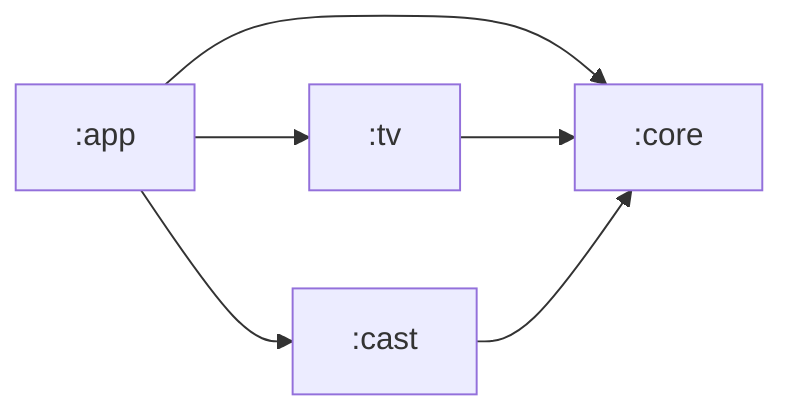
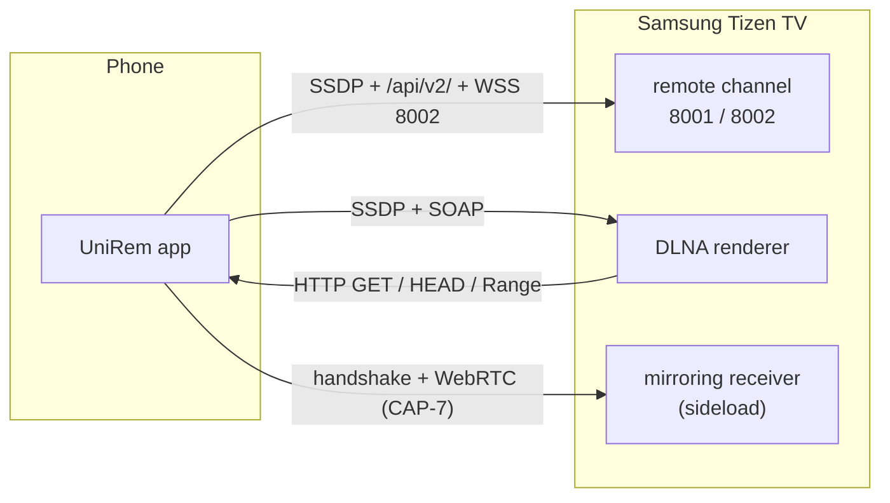
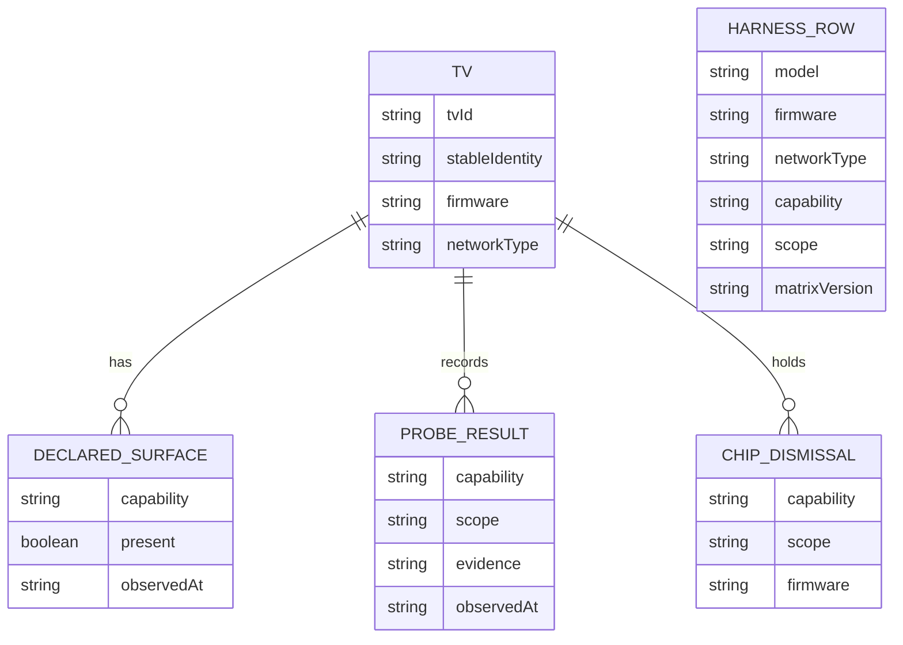

# Architecture Spine — UniRem

## Design Paradigm

**Deep modular monolith.** One Android application, four Gradle modules, one acyclic graph. Ports exist only where a protocol is genuinely swappable: the Samsung local-control channel and the DLNA renderer. Everything else is a package inside its owning module. There is no `:domain`, no `:data`, no usecase layer, and no universal-TV abstraction.

Each adapter exposes one small public surface and keeps its protocol vocabulary — `KEY_*`, SOAP actions, SSDP headers, TLS pinning — `internal`. `:app` never imports a protocol type.

- `:app` — Compose UI, navigation, ViewModels, process-scoped session owners, foreground-service adapters, Room, Hilt composition root. Mirroring (MediaProjection and WebRTC) lives here behind the receiver contract.
- `:core` — pure Kotlin/JVM. Capability keys and resolver, command outcome and evidence types, shared IDs, egress predicate, failure types. No Android dependency.
- `:tv` — Samsung local protocol: SSDP discovery, `/api/v2/` device info, trust-on-first-use pinning, token pairing, WSS channel, keys, text, pointer, wake, reconnect, `CommandTracker`, `ConnectionHealth`.
- `:cast` — `RendererGateway` over jUPnP, bounded media server over Ktor CIO, `CastEngine`.



No other project dependencies exist. `:core` has no outgoing edge.

## Invariants & Rules

### AD-1 — Four modules, one direction, one public surface

- **Binds:** all
- **Prevents:** per-feature module sprawl; protocol types leaking into the UI; a universal-TV abstraction before a second ecosystem exists; a shared predicate or gate with no legal home.
- **Rule:** the Gradle graph is exactly `:app → :tv, :cast, :core`; `:tv → :core`; `:cast → :core`. `:core` applies `org.jetbrains.kotlin.jvm` and has no Android dependency. Cross-module public declarations are limited to: (a) the seams `TvControl` (with `RemoteCommand`, `TextOp`, `PointerOp`), `RendererGateway`, `CastEngine`, and their input/output types; (b) `:core` shared values `TvId`, `SessionId`, `MediaId`, `StableIdentity`, `CommandOutcome`, `Evidence`, `CapabilityKey`, `CapabilityScope`, `CapabilityLabel`, `CapabilityInput`, `PrivatePeer`, `LanAccess`, `SessionState`, `NetworkType`, `TvFailure`, `CastFailure`, `MirrorFailure`, `RedactedLog`; (c) the consumer-owned port `PairingStore`, declared by `:tv` and implemented in `:app`; (d) each module's state owner `CommandTracker` and `ConnectionHealth` in `:tv`. Public declarations live in a module's `api` package; everything else is `internal`. A review check rejects a public declaration outside `api`.

### AD-2 — Command truth is per gesture and evidence-backed

- **Binds:** CAP-1, CAP-2, CAP-3, CAP-4, CAP-5, CAP-8
- **Prevents:** a socket write shown as success; the ring strobing on D-pad repeat; stale evidence resolving a newer press; a press resolving across a socket restart; user confirmation rendered as machine confirmation.
- **Rule:** one `CommandTracker` per target TV, owned by `:tv`, exposes `StateFlow<CommandOutcome>`. Adapters emit `Evidence` — `TvEvent`, `StateProbe`, or `UserConfirmed` — and never a verdict. The tracker holds a monotonic gesture generation bound to the socket instance, ignores evidence for older generations, and applies an injected timeout (3s default, per-capability override). Tracker lifetime is exactly the socket session: created with the channel session and cancelled with it; on close or target change the open generation resolves to `Idle`, never `Unconfirmed` or `Observed`. `:app` calls `submit()` exactly once per user-expressed command on every surface — D-pad tap, function key, voice result, dictation Send, text Send, pointer click; repeat frames and synthesized press/release never submit. `TvControl`'s operation set is fixed: `submit(RemoteCommand)` starts exactly one tracked gesture, `press`/`release` carry repeat edges, text carries an explicit IME start/commit/end lifecycle, pointer carries one named coordinate space — absolute TV panel coordinates, clamped, converted only inside `:tv` and pinned by a fixture against the protocol reference — and wake is a separate operation. Exactly one repeat engine exists, in `:tv`; `:app` owns the 500ms/80ms UX thresholds as injected configuration and never emits repeat frames itself. `RemoteCommand` is the single typed vocabulary; voice, text, and pointer mapping tables target it. `Observed` carries its provenance, and UI copy distinguishes machine observation from user confirmation. Wake maps its probe result to the same three visual states; cast transport is owned by the session chip and transport UI, not the ring.

### AD-3 — Four owned values, four writers

- **Binds:** all
- **Prevents:** a reconnect timer resolving a command; a cast session expiring with the command timeout; wake and reconnect fighting over the same 8001/8002 observation; two power states on screen at once.
- **Rule:** command outcome, connection health, session lifetime, and TV power state are separate types with one writer each. `ConnectionHealth` in `:tv/channel` owns every 8001/8002 observation and the power state `On`, `Asleep`, or `Unknown`; wake requests a probe and consumes its `StateProbe` instead of opening its own sockets. Probe and thin connections are tagged and never counted by health, backoff, or `clientConnect` handling. No shared timer and no shared state object. `:app` may combine the four read-only for display, with fixed precedence: identity changed, then unauthorized or pairing required, then offline, then reconnecting, then asleep, then awake. A lower-precedence state never contradicts a higher one on screen.

### AD-4 — Capability labels are earned per key, never assumed

- **Binds:** CAP-1, CAP-2, CAP-3, CAP-4, CAP-5, CAP-6, CAP-7, CAP-8
- **Prevents:** model tables overriding what the device declares; a probe promoting a capability; user confirmation rewriting a label; a native-field pass claiming an app-grid pass; two modules caching different answers.
- **Rule:** a capability is resolved per `CapabilityKey` — a capability plus one `CapabilityScope` from `Device`, `NativeField`, `AppGrid`, `PointerBrowser`, `PointerAppGrid`, `FormatJpeg`, `FormatMp3`, `FormatH264Aac`, `FormatHevc`, `Subtitles`, `Seek`. `CapabilityResolver` in `:core` evaluates in order: (1) a declared device-level surface is absent → `Not supported` for every scope of that capability; (2) a probe hard-fails for this key → `Not supported` for this key; (3) a matrix pass for this key → `Works`; (4) a matrix partial or ambiguous result, or H/J generation → `Best-effort`; (5) no row and no probe → `Not tested`. Declared device-level surfaces are the UPnP service and action list and `TokenAuthSupport`; IME events are `TvEvent` evidence, not declarations. User confirmation changes command provenance only. `:app` has exactly one capability display owner; every surface reads the same flow, recomputed from the input tuple and never from a stored label.

### AD-5 — The matrix is versioned, code-readable data

- **Binds:** CAP-1, CAP-2, CAP-3, CAP-4, CAP-5, CAP-6, CAP-7, CAP-8
- **Prevents:** a spreadsheet and a release claim diverging; a hard-coded per-model boolean; an unknown firmware silently inheriting a known row; a debug row satisfying a release gate; two network-type vocabularies.
- **Rule:** the verification matrix is a versioned in-repo artifact keyed by byte-exact model and firmware strings, a closed `NetworkType` of `Wifi`, `Ethernet`, or `Unknown`, and `CapabilityKey`. An unknown firmware matches only a literal `*unknown*` row, never a wildcard. Exactly one component in `:app` determines `NetworkType` from the observed path, never from display text. Every row carries `matrixVersion`, and a firmware change invalidates any stored snapshot. `:core` defines the schema and resolution; `:app` loads the asset and passes rows in. A debug harness writes to a debug-only Room overlay table; the resolver takes asset rows plus overlay rows in debug builds, with the exact-key overlay winning, and release builds read the asset only. Overlay rows never satisfy a release gate. Readers never normalize.

### AD-6 — Session ownership follows the user, not the screen

- **Binds:** CAP-1, CAP-6, CAP-7, CAP-8
- **Prevents:** navigation or a TV switch killing a cast; the server self-terminating while the UI shows a live session; a backgrounded app holding the remote socket; a force-stop presented as survival; two owners of locks or session state; two different products when notifications are denied.
- **Rule:** `CastSessionOwner` and `MirrorSessionOwner` in `:app` are the sole writers of `SessionState`, each with exactly one `end(reason)`. `:cast`, the renderer, the media server, and the foreground service publish facts only and never write session state or end a session. A renderer stop is a fact the owner maps to an end reason from the closed set `UserStop`, `RendererError`, `TvDisconnected`, `ProcessDeath`, `OwnerCancelled`. The media server's idle grace window is at least the owner's liveness window and it never self-terminates while an unended session claims it. At most one pinned session exists at a time; starting a second requires ending the first. The remote socket is UI-scoped and closes when the Remote surface leaves the foreground. Wake and Wi-Fi locks are owned exclusively by the session owner, acquired after start, and released only in `end()`; the foreground service, notification, and Activity consent hand-off never acquire locks. MediaProjection consent is requested by an Activity and handed to the owner, which never launches UI. If `POST_NOTIFICATIONS` is denied, the session is foreground-only and ends on background with the fixed copy; the foreground service starts only for a session allowed to outlive the foreground. Process death ends the session, and the next launch reports it ended without restarting it.

### AD-7 — Per-TV trust boundary and one identity

- **Binds:** CAP-1, CAP-8
- **Prevents:** sending a token to an unverified host; a trust-all manager; a silent WSS-to-WS downgrade; pairing secrets in logs or backups; the same TV becoming two records and two Keystore aliases; a NIC change read as an identity change.
- **Rule:** `StableIdentity` has fixed precedence — the device ID the TV reports first, the MAC second, byte-exact as reported, with one normalization rule applied identically everywhere — and `TvId` is the hash of exactly that. A durable TV record and Keystore alias are created only against a resolved identity; a manual-IP target with no resolvable identity is session-only and says so. Identity is immutable per TV record and is never derived from the current connectivity path. A client scoped to one TV validates the leaf SPKI pin before attaching the token; a mismatch enters a visible re-pair flow. No trust-all `X509TrustManager`, no hostname-check suppression outside the pinned client, and no fallback from WSS to WS. Pairing material is Keystore-backed and backup-excluded. Room stores the TV record and the Keystore alias, never the token or pin; `:tv` is the only reader of the alias. The wake MAC is a separate stored field with its own provenance and network type. Token, pin, and SPKI are never logged.

### AD-8 — Egress is one predicate, with a named wake allowlist

- **Binds:** CAP-1, CAP-5, CAP-6, CAP-8
- **Prevents:** a permissive network-security-config becoming an open egress path; two private-address predicates that disagree on 172.16/12; the wake broadcast blocked by the rule that requires it; a socket-factory bypass hiding the exception.
- **Rule:** `:core` owns exactly one `PrivatePeer` predicate over a typed destination and purpose. It allows IPv4 RFC1918 (`10/8`, `172.16/12`, `192.168/16`), IPv4 link-local (`169.254/16`), and IPv6 link-local (`fe80::/10`); global IPv6 and IPv6 ULA are deferred. The wake purpose additionally allows the subnet-directed broadcast computed from the active `LinkProperties` and `255.255.255.255`, on UDP ports 9 and 7 only, from a socket bound to the private interface. The OkHttp interceptor, the jUPnP transport configuration, both discovery filters, the media server's inbound peer check, and the wake sender call this one implementation; no second predicate exists in any module and no send path bypasses it. The network-security-config permits cleartext and says why; the wake allowlist lives inside the predicate, never outside it.

### AD-9 — Cast serving is bounded, and `:cast` owns the item

- **Binds:** CAP-6
- **Prevents:** serving arbitrary files; path traversal; a media URL outliving its session; a `content://` URI leaking to the TV; two `MediaId` authorities; a picker grant that dies with process death being presented as playable.
- **Rule:** `:cast` mints `MediaId`, owns the URL path shape, the id-to-bytes mapping, and the single DIDL-Lite and `protocolInfo` assembly. `:app` hands the picked `Uri` plus metadata and never a URL. The item's bytes are guaranteed readable for the session by one mechanism: a persistable read grant where the picker offers one, re-validated at session start, with a session-cache copy as fallback under one byte limit checked against free space; unreadability at start is `CastFailure.ItemUnreadable`. The TV receives an `http(s)` URL with the `MediaId` that also appears in diagnostics. The server supports `HEAD` and byte `Range`, binds to the interface address through which the TV was reached, rejects non-private peers, serves only the session's selected item, and stops at the owner's `end()`. No `content://` URI crosses the boundary. If the route changes, the session restarts serving on the new address or ends visibly. Ktor CIO with `ktor-server-partial-content` is the pinned engine; Spike C validates start, `HEAD`, and byte `Range` on a real device before the Cast slot is enabled, and any replacement must satisfy this AD with no second server present.

### AD-10 — Mirroring is one handshake and a versioned contract

- **Binds:** CAP-7
- **Prevents:** a presence check that disagrees with the handshake; two incompatible contract majors; a mirror surface that appears without a receiver; capture consent requested before readiness; an invented endpoint or port.
- **Rule:** the receiver contract is a versioned in-repo artifact owned with the receiver and is the single source for endpoint discovery, transport binding, message names, and payload schema. The spine fixes the envelope. One handshake: `hello` then `helloAck`; the Mirror sheet's "Check again" retries this handshake, and there is no separate presence ping. `hello` carries `contractMajor`, `appVersion`, and the viewer-auth request. `helloAck` carries `contractMajor`, `contractMinor`, `receiverVersion`, the receiver-issued viewer and session tokens, `codecs`, `maxResolution`, and the signalling handle. Major must match and the app minor must not exceed the receiver minor; otherwise `MirrorFailure.VersionMismatch`. The failure taxonomy is `ReceiverAbsent`, `VersionMismatch`, `ViewerRejected`, `Busy`, `SignallingFailed`, `MediaFailed`. Transport is a local WebSocket to the receiver control endpoint named by the contract; cleartext is allowed only under AD-8's private-peer rule and no cloud relay exists. Viewer auth is receiver-issued, per-session, short-lived, never logged, and requires no account. No `helloAck` means no mirror surface and no MediaProjection consent. The receiver is a separate Tizen codebase and is not a Gradle module.

### AD-11 — One LAN gate owns access, discovery, and diagnostics

- **Binds:** CAP-1, CAP-2, CAP-3, CAP-4, CAP-5, CAP-6, CAP-7, CAP-8
- **Prevents:** each protocol launching its own permission UI; API 37 enforcement breaking discovery silently; two multicast locks; the denied state collapsing into "TV didn't answer"; the gate's result having no legal cross-module type.
- **Rule:** one app-level `LanAccessGate` owns the local-network permission, the single process-wide `MulticastLock`, the isolation diagnostic, and the manual-IP path. It publishes `LanAccess` (`Granted`, `Denied`, `NotDeclared`) from `:core`. `:tv` and `:cast` consult it before any attempt and map denial to exactly one failure each — `TvFailure.LanDenied` and `CastFailure.LanDenied` — which `:app` maps to the single gate explainer. Neither module requests permissions or launches UI. jUPnP's own multicast lock is disabled and both discovery paths use the gate's scoped handle. A denied gate blocks scan and manual IP identically. Notifications and microphone permissions are outside this gate and are requested in their own context.

### AD-12 — Voice is command mapping, not audio streaming

- **Binds:** CAP-4
- **Prevents:** raw audio sent to the TV; audio retained on disk; two phrase-to-command tables; a voice path that bypasses the LAN-only command rule.
- **Rule:** UniRem never records, stores, or transmits audio itself. It uses the platform speech recognizer and consumes only the final text or command; the permission explainer says "Speech is handled by your phone" and never claims on-device recognition unless the platform guarantees it. There is no background capture and no wake word. Raw audio is never sent to the TV and raw-audio injection is out of scope. One versioned in-app `VoiceCommandMap` maps recognized phrases to the same `RemoteCommand` type used by the D-pad and text paths. A recognized phrase becomes exactly one user-expressed command and therefore exactly one `submit()`.

## Consistency Conventions

| Concern | Convention |
| --- | --- |
| Naming | Gradle modules `:app`, `:core`, `:tv`, `:cast`; base package `com.unirem`; adapters suffix `Gateway` or `Control`; state owners `Tracker`, `Session`, or `Health`; pure functions `Resolver` or `Mapper`. `Manager`, `Helper`, and `Util` are banned except `RedactedLog`. |
| Visibility | A cross-module surface is an interface plus a factory; everything else is `internal`. Public declarations live in `api`. `:app` never imports `okhttp3`, `org.jupnp`, `KEY_*`, or a protocol frame type. |
| Command types | `CommandOutcome` is `Submitted`, `Unconfirmed(reason)`, `Idle`, or `Observed(provenance)`; `Evidence` is `TvEvent`, `StateProbe`, or `UserConfirmed`. No boolean named `confirmed`. |
| Capability keys | `CapabilityKey` is a capability plus a `CapabilityScope`; no free-string scope. Matrix rows, probe results, chip dismissals, and resolver inputs all use the same key type. |
| IDs | `TvId` is the hash of `StableIdentity`, never IP; `SessionId` is UUIDv4; `MediaId` is 128-bit random, base64url, minted by `:cast`; gesture generation is a monotonic `Long` per socket session. |
| Time | `Instant` in UTC at every boundary and in storage; local formatting only in `:app`. Firmware is the byte-exact string the TV reports and is never normalized. |
| Errors | One sealed failure type per module (`TvFailure`, `CastFailure`, `MirrorFailure`); no exception crosses a module boundary; user copy lives in `:app`. |
| State | One writer per state object. Owners expose `StateFlow` and mutate through `update {}` internally; no `MutableStateFlow` escapes; no global mutable state except process-scoped session owners. |
| Persistence | Room stores TV records, declared-surface observations, probe results, chip dismissals, and the debug harness overlay. Inputs only: no resolved label is stored for display. DataStore owns scalars and debug flags; Keystore owns token and pin. Matrix data is a read-only asset. |
| Logging | `RedactedLog` only. Never log token, pin, SPKI, text payloads, cast media IDs or URLs, or a full MAC; log a `TvId` prefix. No `println`, and no direct `Log` call outside the sink. |
| Config | BuildConfig carries build-time flags only and no secrets. Runtime flags live in DataStore. Matrix data and the voice command map are versioned with the app. |
| Network | Key, text, pointer, and voice-derived commands are local-LAN only; no cloud fallback in the press path. Every outbound destination passes `PrivatePeer`; the wake broadcast is the only allowlisted exception. |
| Testing | `:core` is JVM-only with no Android test dependency. Pure logic in `:tv` and `:cast` is JVM-tested. Keystore, sockets, and MediaProjection are instrumentation-only. No test asserts a socket write as success. |
| Build | AGP 9 built-in Kotlin supplies Android compilation; KGP is pinned on the root buildscript classpath and `kotlin-android` is not applied. `kotlinOptions {}` is replaced by `kotlin { compilerOptions {} }`. The Compose compiler plugin matches the Kotlin version. |

## Stack

| Name | Version |
| --- | --- |
| Gradle | 9.5.0 |
| Android Gradle Plugin | 9.3.1 |
| JDK | 17 |
| Kotlin | 2.4.21 (KGP on the root buildscript classpath; AGP built-in Kotlin; `kotlin-android` not applied) |
| Compose compiler plugin | 2.4.21 |
| KSP | 2.3.12 |
| Compose BOM | 2026.09.00 |
| Activity Compose | 1.13.0 |
| Lifecycle | 2.11.0 |
| Navigation Compose | 2.10.2 |
| Hilt | 2.60.1 |
| Hilt Navigation Compose | 1.4.0 |
| Room | 2.8.5 |
| DataStore | 1.3.0 |
| OkHttp | 5.5.1 |
| kotlinx.serialization | 1.12.0 |
| kotlinx-coroutines | 1.11.0 |
| jUPnP | 3.0.5 |
| Ktor CIO with Partial Content | 3.6.0 |
| compileSdk | 37 |
| targetSdk | 36 |
| minSdk | 26 |

## Operations & Platform Envelope

| Area | Decision |
| --- | --- |
| Distribution | Signed AAB to Play internal testing, then production; signing key held by the project owner. The Tizen receiver stays a dev-mode sideload for V1. |
| Telemetry | None in V1: no analytics, crash-reporting, or remote-config SDK. Adding one requires an AD-8 exemption and a UX copy change. |
| Environments | `debug` includes the matrix harness and overlay, verbose redacted logs, and strict-mode checks. `release` reads the asset matrix only and has no harness. There is no backend and no staging environment. |
| CI | Every change runs the Gradle build, lint, and `:core` JVM tests. Instrumentation and physical matrix runs are manual on owned TVs; results are committed as matrix rows. |
| Permissions | `INTERNET`, `ACCESS_NETWORK_STATE`, `ACCESS_WIFI_STATE`, `CHANGE_WIFI_MULTICAST_STATE`, `POST_NOTIFICATIONS`, `RECORD_AUDIO` for the Voice sheet, `VIBRATE` (normal install-time, haptics only), the local-network permission for API 37, and MediaProjection consent from an Activity. No storage permissions; the Photo Picker is the only picker. |
| FGS types | Cast `connectedDevice`; mirror `mediaProjection`; voice `microphone`. Only for user-started sessions. |
| Multicast | `LanAccessGate` owns the single process-wide `MulticastLock`; jUPnP's own lock is disabled. |
| Secrets | Keystore only. No secret in BuildConfig, resources, or logs; pairing material is backup-excluded. |

## Structural Seed

```text
UniRem/
  settings.gradle.kts
  gradle/libs.versions.toml
  app/
    src/main/kotlin/com/unirem/
      ui/            # Compose screens, ring, touchpad, sheets
      nav/           # one NavHost, type-safe routes
      session/       # CastSessionOwner, MirrorSessionOwner, FGS adapters
      data/          # Room, DataStore, PairingStore implementation, matrix loader
      di/            # Hilt composition root
      mirror/        # MediaProjection and WebRTC behind the receiver contract
  core/
    src/main/kotlin/com/unirem/core/
      capability/    # CapabilityKey, labels, precedence resolver, matrix schema
      command/       # CommandOutcome, Evidence, provenance
      model/         # TvId, SessionId, MediaId, StableIdentity, failures
      net/           # PrivatePeer, LanAccess
  tv/
    src/main/kotlin/com/unirem/tv/
      discovery/     # SSDP, manual IP
      pairing/       # /api/v2/, TOFU pin, token exchange
      channel/       # WSS client, frames, ConnectionHealth, backoff
      command/       # CommandTracker, press and release, text, pointer
      wake/          # magic packet, probe request
  cast/
    src/main/kotlin/com/unirem/cast/
      renderer/      # RendererGateway, jUPnP adapter
      server/        # bounded Ktor CIO media server
      session/       # CastEngine facts, MediaId, DIDL
  tizen-receiver/    # separate web app; not a Gradle module
```





## Capability → Architecture Map

| Capability / Area | Lives in | Governed by |
| --- | --- | --- |
| CAP-1 local keys | `:tv` channel, `CommandTracker`, `ConnectionHealth`; `:app` ring | AD-2, AD-3, AD-4, AD-7, AD-11 |
| CAP-2 text entry | `:tv` IME events and text frames; `:app` keyboard sheet | AD-2, AD-4 |
| CAP-3 pointer | `:tv` pointer frames; `:app` touchpad | AD-2, AD-4 |
| CAP-4 voice | `:app` speech-to-text and `VoiceCommandMap`; `:tv` execution | AD-2, AD-4, AD-12 |
| CAP-5 power and wake | `:tv` wake sender and power state; `:app` setup checklist | AD-3, AD-4, AD-8, AD-11 |
| CAP-6 cast | `:cast` renderer, media server, MediaId; `:app` session owner and FGS adapter | AD-6, AD-8, AD-9 |
| CAP-7 mirror | `:app` mirror pipeline and receiver contract | AD-6, AD-10 |
| CAP-8 pair and multi-TV | `:tv` pairing and identity; `:app` Room and target selection | AD-4, AD-6, AD-7, AD-11 |

## Open Questions

- The application ID and package base `com.unirem` are seed values; confirm before the first signed build, because changing them after release creates a new app identity.
- Per-capability timeout values are set by Spike A; the spine fixes only the 3s default and the injection point.
- The WebRTC client artifact and codec set are selected by Spike M; no library is pinned until that spike reports.
- Global IPv6 and IPv6 ULA support are deferred; V1 egress covers IPv4 private, IPv4 link-local, and IPv6 link-local only.
- The receiver contract artifact must exist before the Mirror slot is enabled; its endpoint discovery and exact message names are receiver-owned, while the envelope in AD-10 binds both sides.

## Deferred

- `:mirror` module extraction — mirroring starts in `:app`; extract it if the WebRTC SDK's size or build time hurts, or if a second receiver backend appears.
- `build-logic` convention plugins — four modules do not clear the YAGNI bar; revisit at six or more.
- Design-system module — one dark theme and one screen family; components stay in `:app/ui`.
- UPnPCast swap — only if its Central provenance resolves or a pinned artifact is formally accepted; `RendererGateway` is the seam.
- Backoff curve — `ConnectionHealth` owns it; the type and owner are fixed here.
- Media-server engine fallback — if Spike C rejects Ktor CIO on Android, the replacement must satisfy AD-9 and AD-8 and no second server may coexist.
- Matrix columns beyond the spec template — bmad-spec owns them; this spine fixes the artifact, key semantics, and consumption.
- Background cast notification actions — UX owns the surface.
- H/J 2014–15 specifics — best-effort and matrix-gated; no separate code path until a spike proves one is needed.
- Tizen receiver internals and the contract's exact schema — separate codebase; only the envelope and the version negotiation are fixed here.
- Raw voice injection — spike-gated and outside the launch commitment.
